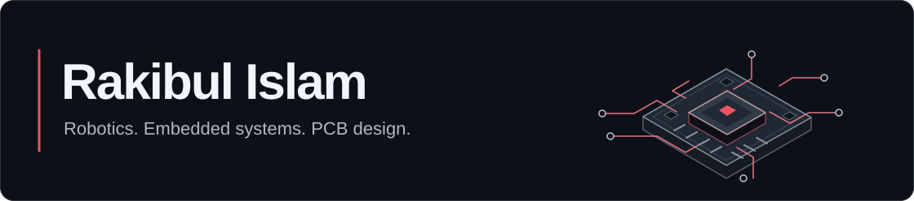

<picture>
  <source media="(max-width: 600px)" srcset="./assets/header-mobile.svg" />
  
</picture>

I build robots, custom electronics and the software around them. My work spans PCB design, embedded firmware, control systems and CAD. I’m studying **Electrical and Electronics Engineering at BRAC University**.

[Portfolio](https://rakibulislam1.github.io/portfolio/) · [All repositories](https://github.com/RakibulIslam1?tab=repositories)

## Selected work

### Robotics & embedded systems

- **[Indur](https://github.com/RakibulIslam1/indur)** — An ESP32-S3 micromouse with infrared wall sensing, magnetic wheel encoders and flood-fill navigation.
- **[SROT Control Board](https://github.com/RakibulIslam1/srot-control-board)** — Underwater flight-control firmware with an ESP32 controller and a Pico 2 thruster backend. Companion tools: [ESC flasher](https://github.com/RakibulIslam1/srot-esc-flasher) and [Bondor ground station](https://github.com/RakibulIslam1/srot-ground-station).
- **[Team LazyGo](https://github.com/RakibulIslam1/LazyGo_WRO2025)** — Hardware and CAD design for our WRO 2025 autonomous rover.
- **[Mongla](https://github.com/RakibulIslam1/mongla_ws)** — A collaborative ROS 2 autonomy workspace for underwater vehicles.

### Tools & apps

- **[IndurUI](https://github.com/RakibulIslam1/indur-ui)** — An Arduino OLED interface library for live telemetry, small-screen menus and persistent settings.
- **[ScholarsPilot](https://github.com/RakibulIslam1/scholarspilot-downloads)** — An Android money-management app for students. The public showcase includes the case study, screenshots and pilot builds.

## Working with

C/C++ · Python · ROS 2 · ESP32 · Arduino · PCB design · CAD  
React Native and TypeScript on the app side.

## Competition robotics

- **WRO 2025:** 6th worldwide with a full score — **Team LazyGo**.
- **RoboSub 2026:** 8th worldwide — **BRACU Duburi**.
